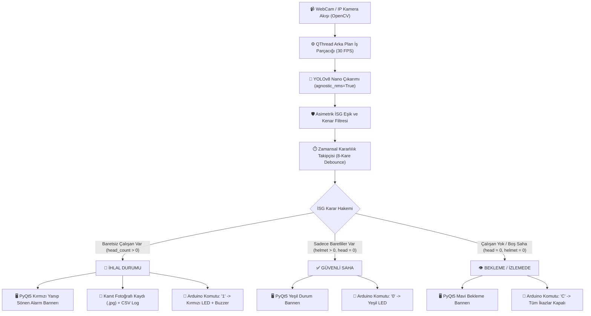

# 🦺 Yapay Zekâ Destekli Gerçek Zamanlı Baret ve İSG İkaz Sistemi
### AI-Powered Real-Time Safety Helmet & PPE Compliance Monitoring System

[](https://www.python.org/)
[](https://github.com/ultralytics/ultralytics)
[](https://pypi.org/project/PyQt5/)
[](https://www.arduino.cc/)
[](LICENSE)
[]()

> **Bandırma Onyedi Eylül Üniversitesi — Mühendislik ve Doğa Bilimleri Fakültesi**  
> **Ders:** Veri Bilimi Dersi Dönem Projesi (Grup 9)  
> **Danışman:** Doç. Dr. Serhat KILIÇARSLAN  

---

## 📌 Proje Genel Bakışı (Executive Summary)

İnşaat, maden, lojistik ve ağır sanayi sahalarında iş kazalarının önemli bir bölümü baş yaralanmalarından kaynaklanmaktadır. Bu proje; şantiye ve endüstriyel tesis girişlerinde veya kritik çalışma bölgelerinde çalışanların **baret kullanımını gerçek zamanlı bilgisayarlı görü (YOLOv8)** ile denetleyen, **3 durumlu endüstriyel karar mekanizması** ile yöneten ve **Arduino Uno R3 tabanlı sesli-ışıklı donanım ikazları** üreten bütünleşik bir İş Sağlığı ve Güvenliği (İSG) denetim platformudur.

Sistem; klasik kare-kare çalışan basit nesne tanıma yazılımlarının aksine, **Zamansal Kararlılık Takipçisi (Temporal Debounce Tracker)** mimarisine sahiptir. Bu sayede ani kafa çevirmelerinde, hareket bulanıklığında (motion blur) veya saç parlamalarında oluşan yanlış tespitler (false positives) matematiksel olarak elenir; stabil, sinematik ve hatasız bir tespit deneyimi sunulur.

---

## 🚀 Öne Çıkan Temel Özellikler

- **🎯 YOLOv8 Nano Tabanlı Yüksek Hızlı Çıkarım:** 640x640 çözünürlükte 30+ FPS akıcılık (GPU destekli CUDA ve optimize CPU modu).
- **🧠 Zamansal Kararlılık Takipçisi (Temporal Debounce Tracker):** 
  - 8 karelik zamansal kayan pencere (rolling window).
  - Ani hareket bulanıklığında veya saç gölgelerinde yanlış baret sıçramalarını önleyen histerezis filtresi.
  - Yumuşatılmış sınır kutuları (Exponential Moving Average / EMA).
- **⚖️ 3 Durumlu İSG Hakem Mimarisi:**
  1. 🚨 **İHLAL (Baretsiz Çalışan):** Kırmızı yanıp sönen alarm bannerı, Arduino Kırmızı LED + 5V Aktif Buzzer kesikli siren ikazı, disk üzerine tarih/saat filigranlı kanıt kaydı.
  2. ✅ **GÜVENLİ (Baretli Çalışan):** Yeşil durum bannerı, Arduino Yeşil LED aktif.
  3. 👁️ **BEKLEME / SAHA İZLEMEDE (Çalışan Yok):** Boş sahada yanlış güvenli alarmı vermeyen mavi/gri nötr bekleme modu, tüm Arduino ikazları kapalı.
- **🛡️ Asimetrik Güvenlik Eşiği & Kenar Filtresi:** İSG güvenlik önceliği gereği baretsiz kafa tespitinde yüksek hassasiyet (%40-%45), baret teyidinde ise sahte tespitleri eleyen yüksek güven (%68+) kuralı.
- **🔌 Arduino Uno R3 Seri Haberleşme:** USB COM portu üzerinden 9600 baud hızında çalışan hata korumalı (fail-safe) donanım yöneticisi.
- **📊 Dijital Denetim ve Raporlama:** Otomatik kanıt fotoğrafları (`ihlal_YYYYMMDD_HHMMSS.jpg`) ve CSV formatında denetim kütüğü (`ihlal_kayitlari.csv`).
- **💻 Modern PyQt5 Karanlık Arayüz (Dark Glassmorphism):** Canlı FPS sayacı, anlık baretli/baretsiz kişi sayaçları, ayarlanabilir güven eşiği çubuğu ve manuel anlık fotoğraf çekim desteği.

---

## 🏗️ Sistem Mimarisi ve Akış Diyagramı



---

## 🔌 Donanım Bileşenleri ve Devre Bağlantı Şeması

Sistemin saha ikaz donanımı standart bir **Arduino Uno R3** mikrokontrolcüsü ile çalışmaktadır:

| Bileşen | Arduino Pini | Seri Direnç | İşlevi / Açıklama |
| :--- | :--- | :--- | :--- |
| **Yeşil LED** | **Pin 8** | 220Ω – 330Ω | **GÜVENLİ DURUM:** Sahadaki tüm çalışanlar baretli olduğunda yanar. |
| **Kırmızı LED** | **Pin 9** | 220Ω – 330Ω | **KRİTİK İHLAL:** Baretsiz çalışan tespit edildiğinde yanar. |
| **5V Aktif Buzzer** | **Pin 10** | Gerekmez (Doğrudan) | **SESLİ İKAZ:** İhlal anında kesikli (150ms aralıklı) siren/düdük çalar. |
| **GND** | **GND Pini** | — | LED'lerin katot (-) uçları ve Buzzer (-) hattı ortak GND'ye bağlanır. |

### Seri Port Protokolü (9600 Baud)
* **`'1'` (veya `'H'`):** İhlal modu -> Kırmızı LED AÇIK, Buzzer Kesikli AÇIK, Yeşil LED KAPALI.
* **`'0'` (veya `'S'`):** Güvenli mod -> Yeşil LED AÇIK, Kırmızı LED KAPALI, Buzzer KAPALI.
* **`'C'`:** Bekleme modu -> Kırmızı LED KAPALI, Yeşil LED KAPALI, Buzzer KAPALI.

---

## 📂 Proje Dizin Yapısı

```text
Yapay Zeka Destekli Baret Tanıma Sistemi/
│
├── main.py                     # Ana PyQt5 masaüstü uygulaması ve YOLOv8 çıkarım motoru
├── best.pt                     # Eğitilmiş YOLOv8 Nano model ağırlıkları
├── arduino_firmware.ino        # Arduino Uno R3 LED & Buzzer gömülü yazılımı
├── requirements.txt            # Gerekli Python bağımlılıkları kütüğü
├── .gitignore                  # Git hariç tutma kuralları (ağırlıklar, loglar)
├── README.md                   # Proje dokümantasyonu (Bu dosya)
│
└── ihlal_kayitlari/            # (Çalışma anında otomatik oluşturulur)
    ├── ihlal_kayitlari.csv     # Tarih, saat, kişi sayıları ve dosya yolları log kütüğü
    ├── ihlal_20261022_125358.jpg # İhlal anı zaman damgalı kanıt fotoğrafı
    └── ...
```

---

## 🛠️ Kurulum ve Çalıştırma Rehberi

### 1. Gereksinimler
- **İşletim Sistemi:** Windows 10/11, Ubuntu 20.04+, macOS
- **Python:** 3.10 veya üzeri (Python 3.11 / 3.12 / 3.13 test edilmiştir)
- **Donanım:** Standart USB WebCam, Arduino Uno R3, 2x LED, 1x 5V Aktif Buzzer

### 2. Python Ortamının Kurulması
Terminali (PowerShell veya Bash) proje klasöründe açın:

```bash
# Sanal ortam oluşturma (Önerilir)
python -m venv venv

# Sanal ortamı aktif etme
# Windows:
.\venv\Scripts\activate
# Linux/macOS:
source venv/bin/activate

# Bağımlılıkları yükleme
pip install -r requirements.txt
```

### 3. Arduino Yazılımının Yüklenmesi
1. Arduino IDE programını açın.
2. `arduino_firmware.ino` dosyasını açın.
3. **Araçlar -> Kart:** `Arduino Uno` seçin.
4. **Araçlar -> Port:** Cihazınızın bağlı olduğu COM portunu (örneğin `COM3`) seçin.
5. **Yükle (Upload)** butonuna basarak kodu Arduino'ya yükleyin.

### 4. Masaüstü Uygulamasının Başlatılması
```bash
python main.py
```

1. Uygulama açıldığında sol alttaki **Arduino COM Portu** kutusundan portunuzu seçip **"🔌 Arduino'ya Bağlan"** butonuna tıklayın (Arduino takılı değilse yazılımsal modda çalışmaya devam eder).
2. **Kamera Seçimi** kutusundan kameranızı belirleyin ve **"▶ Kamerayı Başlat"** butonuna basın.
3. Sistem anında çalışmaya başlayacak, tespitleri ekrana yansıtacak ve sayaçları güncelleyecektir.

---

## 📊 Model Eğitimi ve Veri Seti Detayları

Model, Roboflow Universe üzerindeki **Hard Hat Universe (v26)** endüstriyel İSG veri seti kullanılarak eğitilmiştir:

- **Eğitim Mimarisi:** YOLOv8 Nano (`yolov8n.pt`) transfer learning
- **Görüntü Sayısı:** 7.034 adet yüksek çözünürlüklü etiketli şantiye görseli
- **Sınıflar:**
  - `0: head` (Baretsiz / Çıplak Kafa — Kritik İhlal Nesnesi)
  - `1: helmet` (Standart Güvenlik Bareti — Güvenli Nesne)
  - `2: hi-viz helmet` (Reflektörlü Yüksek Görünürlüklü Baret)
  - `3: hi-viz vest` (Reflektörlü İkaz Yeleği)
  - `4: person` (Çalışan / İnsan Gövdesi)
- **Eğitim Donanımı:** Google Colab Tesla T4 GPU (CUDA 12.x)
- **Eğitim Parametreleri:** 40 Epoch, Batch Size 16, Image Size 640, AdamW Optimizer
- **Başarım Metrikleri:**
  - `mAP@50 (Genel):` **%89.4**
  - `Baretsiz Baş (head) Hassasiyeti:` **%93.3**
  - `Çıkarım Süresi (Inference Latency):` ~18ms (GPU) / ~55ms (CPU)

---

## 👥 Proje Ekibi ve Teşekkür

* **Danışman Öğretim Üyesi:** Doç. Dr. Serhat KILIÇARSLAN  
* **Kurum:** Bandırma Onyedi Eylül Üniversitesi  
* **Fakülte:** Mühendislik ve Doğa Bilimleri Fakültesi  
* **Bölümler:** Bilgisayar Mühendisliği / Yazılım Mühendisliği / Elektrik-Elektronik Mühendisliği  
* **Ders:** Veri Bilimi Dersi Proje Grubu (Grup 9)  

---
*Bu proje akademik araştırma, açık inovasyon ve iş güvenliği kültürünü geliştirmek amacıyla geliştirilmiştir.*
